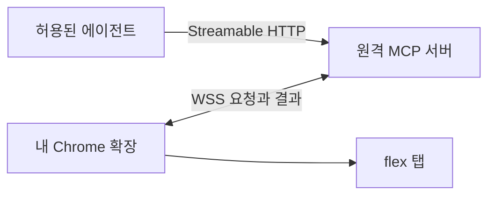

# flex MCP 아키텍처

[LLM Wiki](LLM_WIKI.md) · [개발 환경](README.md) · [서비스 정책](SERVICE_POLICY.md) · [기능 목록](docs/features/README.md) · [유틸 계약](UTILITIES.md)

## 현재 동작

[MCP 서버](apps/mcp-server/src/index.ts)는 로컬 표준 입출력(`stdio`)으로 도구 세 개를 노출합니다. 서버는 도구 입력을 검사합니다. 조회 연결이 없으므로 도구 호출에는 미연결 오류를 반환합니다.

[Chrome 확장](apps/chrome-extension/manifest.json)은 별도로 빌드할 수 있습니다. 서비스 워커는 확장의 백그라운드 진입점입니다. 현재는 flex 탭이나 서버에 접근하는 권한을 요청하지 않습니다.

## 로컬에서 검증한 범위

공통 조회 형식과 검사는 [shared](shared/index.ts)에 둡니다. 두 앱은 각자 필요한 공통 코드를 빌드에 포함합니다. 확장에는 [탭·연결 검사](apps/chrome-extension/src/bridge/index.ts)와 [조회 결과 변환](apps/chrome-extension/src/flex/index.ts)이 있습니다. 서버에는 [접근 권한](apps/mcp-server/src/access/index.ts)과 [요청 중계](apps/mcp-server/src/bridge/index.ts)가 있습니다.

[합성 연결 테스트](apps/mcp-server/test/query-integration.test.ts)는 MCP 도구, 권한 검사, 서버 중계, 브라우저 조회 코드와 결과 검사까지 연결합니다. 합성 조회 어댑터는 테스트에서만 등록합니다. 공개 서버와 확장은 실계정 조회 어댑터를 등록하지 않습니다.

## 원격 연결 설계 · 운영 연결 예정

확장은 서버에 WSS 연결을 시작합니다. 서버는 허용된 에이전트의 요청만 받습니다. 첫 버전은 한 사람의 Chrome 프로필에 요청을 전달합니다. Chrome 프로필은 Chrome의 사용자별 작업 공간입니다.

확장은 연차, 일정, 근무 시간의 읽기 요청만 처리합니다. 확장은 요청이 조회할 URL, 사번, 실행 코드를 받지 않습니다. 서버에 보내는 값은 도구에 필요한 결과로 제한합니다. [공개 저장소 보안 기준](SECURITY.md)을 따릅니다.

브라우저 연결이 끊긴 경우와 flex에 다시 로그인해야 하는 경우를 구분합니다. 메시지와 오류 코드는 [원격 중계](docs/features/remote-bridge.md)에 있습니다.

## 검증 경계

로컬에서는 두 앱의 독립 빌드, 도구 계약, 합성 연결을 확인했습니다. 운영 주소에서 Streamable HTTP와 WSS를 열려면 접속 신원 확인과 운영 설정을 연결해야 합니다. 실제 Chrome에서 탭 접근, 프로필 연결 화면과 재시작 복구도 확인해야 합니다. [투두 7](https://github.com/freevue/flex-mcp/issues/7)에서 실조회 방식을 정한 뒤 연차부터 실제 화면과 대조합니다.
