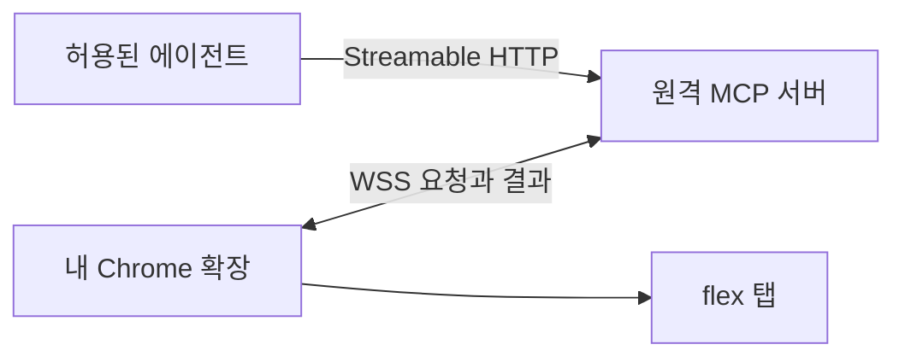

# flex MCP 아키텍처

[LLM Wiki](LLM_WIKI.md) · [개발 환경](README.md) · [서비스 정책](SERVICE_POLICY.md) · [기능 목록](docs/features/README.md) · [유틸 계약](UTILITIES.md)

## 현재 동작

[MCP 서버](apps/mcp-server/src/index.ts)는 로컬 표준 입출력(`stdio`)으로 도구 세 개를 노출합니다. 서버는 도구 입력을 검사합니다. 조회 연결이 없으므로 도구 호출에는 미연결 오류를 반환합니다.

[Chrome 확장](apps/chrome-extension/manifest.json)은 별도로 빌드할 수 있습니다. 서비스 워커는 확장의 백그라운드 진입점입니다. 현재는 flex 탭이나 서버에 접근하는 권한을 요청하지 않습니다.

## 원격 연결 설계 · 구현 예정

확장은 서버에 WSS 연결을 시작합니다. 서버는 허용된 에이전트의 요청만 받습니다. 첫 버전은 한 사람의 Chrome 프로필에 요청을 전달합니다. Chrome 프로필은 Chrome의 사용자별 작업 공간입니다.

확장은 연차, 일정, 근무 시간의 읽기 요청만 처리합니다. 확장은 요청이 조회할 URL, 사번, 실행 코드를 받지 않습니다. 서버에 보내는 값은 도구에 필요한 결과로 제한합니다. [공개 저장소 보안 기준](SECURITY.md)을 따릅니다.

브라우저 연결이 끊긴 경우와 flex에 다시 로그인해야 하는 경우를 구분합니다. 메시지와 오류 코드는 [원격 중계](docs/features/remote-bridge.md)에 있습니다.

## 검증 경계

로컬 검사에서는 두 앱의 독립 빌드와 서버의 도구 계약을 확인합니다. 실제 Chrome 조회와 원격 연결은 구현 후 확인합니다. 첫 실제 조회는 연차 도구로 진행합니다.
