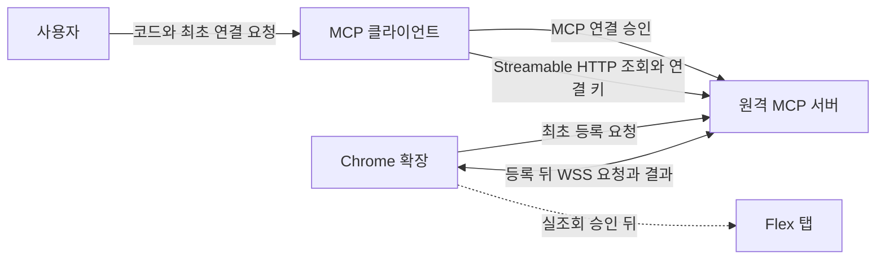

# flex MCP 아키텍처

[LLM Wiki](LLM_WIKI.md) · [개발 환경](README.md) · [서비스 정책](SERVICE_POLICY.md) · [기능 목록](docs/features/README.md) · [유틸 계약](UTILITIES.md)

## 현재 동작

[MCP 서버](apps/mcp-server/src/index.ts)는 로컬 표준 입출력(`stdio`)으로 데이터 조회 세 개와 [Chrome 소켓 상태 조회](docs/features/socket-status.md), 연결 승인 도구를 노출합니다. 서버는 도구 입력을 검사합니다. 조회 연결이 없으므로 도구 호출에는 미연결 오류를 반환합니다.

[Chrome 확장](apps/chrome-extension/manifest.json)은 별도로 빌드할 수 있습니다. 서비스 워커는 확장의 백그라운드 진입점입니다. 확장은 빌드에서 정한 서버에만 접속합니다. 팝업은 연결 코드 또는 연결 상태를 표시합니다. 합성 모드를 켜면 상태 화면에서 이번 달 근무 요약도 표시합니다. 공개 확장은 Flex 탭에 접근하지 않습니다. 개인 설치본은 [설치와 실조회 절차](docs/features/extension-setup.md)를 따릅니다.

## 로컬에서 검증한 범위

공통 조회 형식과 검사는 [shared](shared/index.ts)에 둡니다. 두 앱은 각자 필요한 공통 코드를 빌드에 포함합니다. 확장에는 [탭·연결 검사](apps/chrome-extension/src/bridge/index.ts)와 [조회 결과 변환](apps/chrome-extension/src/flex/index.ts)이 있습니다. 서버에는 [접근 권한](apps/mcp-server/src/access/index.ts)과 [요청 중계](apps/mcp-server/src/bridge/index.ts)가 있습니다.

[합성 연결 테스트](apps/mcp-server/test/query-integration.test.ts)는 MCP 도구, 권한 검사, 서버 중계, 브라우저 조회 코드와 결과 검사까지 연결합니다. 별도 합성 서버와 확장은 승인한 등록으로 연결합니다. 합성 모드를 켠 확장은 합성 응답을 반환합니다. 실계정 조회 어댑터는 개인 설치본의 Flex 탭에서만 실행합니다. 서버는 도구 결과만 전달합니다.

## 현재 Node 원격 연결

확장은 등록을 요청하고 승인 코드를 표시합니다. 사용자는 코드를 MCP 클라이언트에 보냅니다. 클라이언트가 승인 도구를 호출하면 연결 키를 받습니다. 서버는 요청 키를 가진 확장에만 등록을 반환합니다. [최초 등록 순서도](docs/features/browser-pairing.md)를 참고하세요.

등록 뒤에는 확장이 WSS 연결을 시작합니다. 서버는 연결 키에 해당하는 채널로만 조회를 보냅니다. 채널마다 활성 Chrome 소켓 하나를 유지합니다. [공유 연결 흐름](docs/features/shared-connection-flow.md)에서 조회와 재접속을 확인합니다.

확장은 연차, 일정, 근무 시간의 읽기 요청만 처리합니다. 확장은 요청이 조회할 URL, 사번, 실행 코드를 받지 않습니다. 서버에 보내는 값은 도구에 필요한 결과로 제한합니다. [공개 저장소 보안 기준](SECURITY.md)을 따릅니다.

브라우저 연결이 끊긴 경우와 flex에 다시 로그인해야 하는 경우를 구분합니다. 메시지와 오류 코드는 [원격 중계](docs/features/remote-bridge.md)에 있습니다.

## Cloudflare Workers 배포 설계

Workers 서버는 MCP 요청과 Chrome 채널을 처리합니다. Durable Object는 브라우저 소켓과 등록을 관리하는 Cloudflare 실행 단위입니다. Workers는 이 객체의 SQLite 저장소를 사용합니다. [현재 구현](docs/mcp/worker-implementation.md)과 [배포 설계](docs/mcp/cloudflare-workers.md)에서 확인합니다. 개인 설치본과 공개 합성 확장의 응답을 구분합니다.

## 검증 경계

로컬에서는 두 앱의 독립 빌드, 도구 계약, 합성 연결을 확인했습니다. 원격 합성 서버는 Streamable HTTP와 WebSocket을 제공합니다. [직접 검증 절차](docs/features/shared-connection-check.md)로 설치한 Chrome과 두 사용자의 연결을 확인합니다. MCP 승인과 사용자별 소켓은 [HTTP와 소켓 통합 테스트](apps/mcp-server/test/shared-remote.test.ts)에서 확인합니다. 실제 계정으로 설치한 Chrome에서 연차, 일정과 근무 결과를 Flex 화면과 대조합니다.
