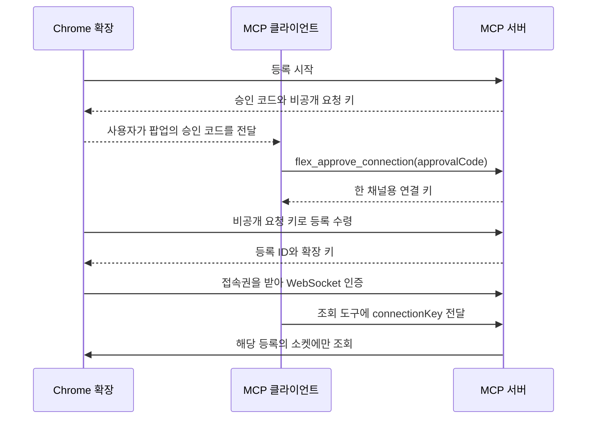

# Chrome 등록과 재접속

[투두 17](https://github.com/freevue/flex-mcp/issues/17) · [채널 접근 권한](access-control.md) · [두 프로필 검증](shared-connection-check.md)

채널은 하나의 Chrome 등록에 연결된 조회 경로입니다. 사용자는 Chrome 팝업에서 일회용 코드를 발급합니다. MCP 클라이언트는 도구를 호출하는 앱입니다. 서버는 클라이언트의 이름이나 사용자 계정을 등록하지 않습니다.

## 연결 순서

팝업은 승인 코드만 표시합니다. 코드는 5분 동안 유효합니다. 서버는 성공한 코드에 연결 키를 한 번만 발급합니다. 연결 키는 확장 등록이 끝나기 전에는 조회에 쓸 수 없습니다. 요청 키를 가진 처음 확장만 등록을 받습니다.

## 키와 경로

| 키 | 사용 위치 | 역할 |
| --- | --- | --- |
| 승인 코드 | MCP 승인 도구 | 팝업의 연결 요청을 한 번 승인합니다. |
| 요청 키 | Chrome 확장 | 승인 결과를 같은 확장이 한 번 수령합니다. |
| 연결 키 | MCP 조회 도구의 `connectionKey` | 해당 채널의 상태와 조회를 허용합니다. |
| 확장 키 | Chrome 확장의 HTTP 인증 헤더 | 접속권을 받거나 등록을 해제합니다. |
| 접속권 | Chrome WebSocket의 첫 메시지 | 30초 안에 소켓을 한 번 인증합니다. |

| 경로 | 입력과 결과 |
| --- | --- |
| `POST /bridge/pair/start` | 등록을 요청합니다. 기존 등록을 교체할 때는 현재 확장 키를 보냅니다. 성공 응답은 201입니다. |
| `POST /bridge/pair/claim` | 요청 키를 보냅니다. 서버는 `pending`, `unavailable` 또는 `registered`를 반환합니다. |
| `POST /bridge/ticket` | 확장 키를 보냅니다. 접속권을 받습니다. |
| `GET /bridge` | WebSocket을 엽니다. 첫 메시지에서 접속권을 보냅니다. |
| `POST /bridge/unpair` | 현재 확장 키를 보냅니다. 서버는 등록과 연결 키를 무효화합니다. |

기존 등록을 바꾸면 서버는 이전 연결 키와 확장 키를 무효화합니다. 새 등록을 받기 전에는 기존 등록을 유지합니다. 같은 등록으로 재접속할 때는 코드를 다시 발급하지 않습니다. 확장은 기존 키로 새 접속권을 받습니다.

## 테스트 케이스

| TC | 입력과 조건 | 기대 결과 |
| --- | --- | --- |
| TC-F-PAIR-01 | 목록을 조회한 뒤 코드 하나를 두 번 제출합니다. | 최초 승인만 연결 키를 반환합니다. |
| TC-F-PAIR-02 | 코드가 만료되거나 다른 요청 키를 보냅니다. | 확장 등록을 발급하지 않습니다. |
| TC-F-PAIR-03 | 처음 요청한 확장이 승인 결과를 받습니다. | 그 등록에만 조회 키를 연결합니다. |
| TC-F-PAIR-04 | 기존 확장의 등록을 바꾸거나 해제합니다. | 이전 키와 대기 요청을 사용할 수 없습니다. |
