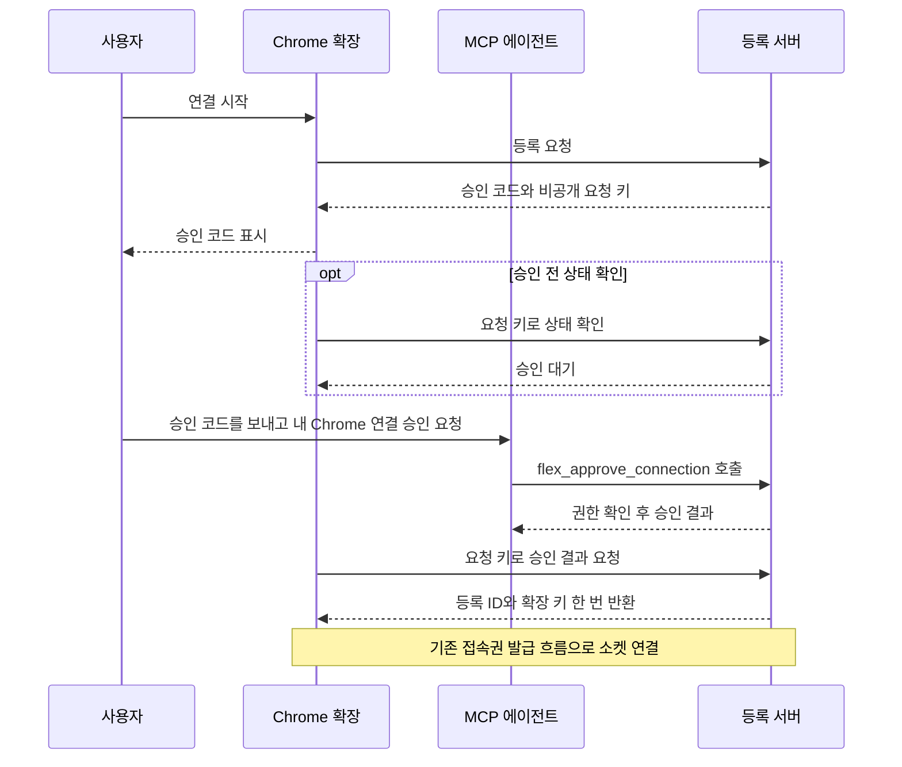

# Chrome 등록과 재접속

[공유 연결 흐름](shared-connection-flow.md) · [팝업과 에이전트 대화](extension-ui-plan.md) · [투두 13](https://github.com/freevue/flex-mcp/issues/13) · [투두 12](https://github.com/freevue/flex-mcp/issues/12)

확장이 등록을 시작합니다. 에이전트가 MCP로 승인합니다. 팝업은 서버 주소나 채널 ID를 받지 않습니다.

## 에이전트가 승인하는 등록

승인 코드는 사용자가 화면에서 확인하는 일회용 값입니다. 요청 키는 처음 요청한 확장이 승인 결과를 받는 값입니다. 등록 ID인 `bindingId`는 서버가 사용자 채널을 찾는 값입니다. 확장 키는 등록 뒤 다시 접속할 때 쓰는 값입니다.

확장은 배포 설정의 서버에 등록을 요청합니다. 서버는 승인 코드와 요청 키를 발급합니다. 팝업은 승인 코드만 표시합니다. 확장은 요청 키를 화면, URL 또는 로그에 넣지 않습니다.

사용자는 팝업의 코드를 에이전트에 보내고 연결 승인을 요청합니다. 에이전트는 `flex_approve_connection`을 호출합니다. 서버는 에이전트의 인증 정보에서 사용자를 확인합니다. 코드나 요청 본문에서 사용자 ID를 받지 않습니다.

서버는 승인을 기다리는 동안 등록을 바꾸지 않습니다. 처음 요청한 확장이 요청 키로 승인 결과를 받으면, 서버는 새 등록을 만들고 기존 등록을 폐기합니다. 서버는 등록 ID와 확장 키를 한 번만 반환합니다.

| 조건 | 서버와 확장의 동작 |
| --- | --- |
| 승인 대기 | 팝업을 열어 두면 확장이 약 2초마다 상태를 확인합니다. 팝업을 닫으면 백그라운드에서도 확인합니다. 확장 키는 발급하지 않습니다. |
| 승인 권한 없음 | 서버는 등록을 승인하지 않습니다. 조회 권한만으로는 승인할 수 없습니다. |
| 승인 거절 또는 만료 | 등록을 만들지 않습니다. 다시 시도하면 새 승인 요청을 시작합니다. |
| 요청 키 없음 또는 불일치 | 승인 코드를 알아도 등록 결과를 받을 수 없습니다. |
| 이미 받은 승인 결과 | 같은 요청 키로 등록 결과를 다시 받을 수 없습니다. |
| 같은 등록으로 재접속 | 승인 절차를 반복하지 않습니다. 기존 확장 키로 접속권을 받습니다. |

## MCP 승인 도구

`flex_approve_connection`의 입력은 `approvalCode` 하나입니다. 서버는 승인 권한과 코드의 유효성을 확인합니다. 최초 등록도 승인할 수 있도록 기존 Chrome 등록은 요구하지 않습니다. 사용자가 연결을 요청했을 때 에이전트가 이 도구를 호출합니다.

승인 도구는 서버의 등록 요청 상태를 바꿉니다. 성공 응답은 승인 결과만 담습니다. 등록 ID, 확장 키와 요청 키는 에이전트에 보내지 않습니다. 승인에 성공해도 소켓이 연결됐다는 뜻은 아닙니다.

[기기 승인 흐름](https://www.rfc-editor.org/rfc/rfc8628.html#section-1.2)은 사용자에게 보이는 코드와 확장만 쓰는 값을 구분하는 참고 규격입니다. 이 프로젝트는 MCP 도구에서 승인을 받습니다. 코드는 5분 동안 유효합니다. 표시 형식은 영문 대문자 A부터 F와 숫자로 된 네 자리 묶음 세 개입니다. 서버는 코드와 요청 키의 해시만 저장합니다.

## 등록과 소켓 API

팝업은 시작과 승인 결과 API를 사용합니다. 이전 운영자 등록 API는 호환 용도로 유지합니다. 이전 코드는 10분 동안 유효하며 팝업에서 받지 않습니다.

확장은 확장 키를 현재 Chrome 프로필의 확장 저장소에 저장합니다. 서버는 원문 대신 해시를 저장합니다. 해시는 값을 비교할 때 쓰는 고정 길이 값입니다.

| 요청 | 입력 | 성공 응답 |
| --- | --- | --- |
| `POST /bridge/pair/start` | 승인된 확장 출처 | `201`: `approvalCode`, `requestKey`, `expiresAt` |
| `POST /bridge/pair/claim` | 승인된 확장 출처와 요청 키를 담은 Bearer 헤더 | `pending`, `unavailable` 또는 `registered`와 등록 정보 |
| `POST /bridge/pair` | 기존 호환 API. JSON의 `code` | `bindingId`, `deviceKey` |
| `POST /bridge/ticket` | 확장 키를 담은 Bearer 헤더 | `ticket` |
| `POST /bridge/unpair` | 확장 키를 담은 Bearer 헤더 | `204` |
| `GET /bridge`의 WebSocket 전환 | 첫 텍스트 메시지 `{"type":"auth","ticket":"예시"}` | `{"type":"ready"}` |

## 등록 후 연결과 해제

접속권은 소켓을 한 번 인증하는 값입니다. 현재 서버는 확장 키를 확인한 뒤 30초 동안 유효한 접속권을 발급합니다. 확장은 소켓의 첫 메시지로 접속권을 보냅니다. 서버는 사용한 접속권을 다시 받지 않습니다.

같은 등록으로 다시 접속하면 서버는 새 소켓에 연결하고 이전 소켓을 닫습니다. 같은 사용자가 새 Chrome을 등록하거나 등록을 해제하면, 서버는 이전 확장 키와 접속권을 무효화합니다. 운영자는 `revoke-browser`로 등록을 해제합니다. 팝업에 해제 버튼은 없습니다.

## 확인할 경우

[HTTP와 소켓 통합 테스트](../../apps/mcp-server/test/shared-remote.test.ts)에서 승인, 다른 사용자 분리, 소켓 조회를 확인합니다. 설치한 Chrome은 [직접 검증 절차](shared-connection-check.md)로 확인합니다.

| TC | 확인할 동작 | 기대 결과 |
| --- | --- | --- |
| TC-F-PAIR-01 | 같은 등록 코드를 두 번 보냅니다. | 두 번째 등록을 거부합니다. |
| TC-F-PAIR-02 | 같은 등록으로 소켓을 다시 엽니다. | 등록 ID가 같고 이전 소켓이 닫힙니다. |
| TC-F-PAIR-03 | 새 코드로 같은 사용자를 등록합니다. | 새 ID를 받습니다. 이전 키와 접속권은 실패합니다. |
| TC-F-PAIR-04 | 등록을 해제합니다. | 해당 등록만 지워집니다. |
| TC-F-PAIR-05 | 만료된 접속권이나 사용한 접속권을 보냅니다. | 소켓을 등록하지 않습니다. |
| TC-F-PAIR-06 | 승인 권한이 있는 에이전트에 코드를 보내 연결을 요청합니다. | 서버는 호출자의 사용자에게 등록을 묶습니다. 처음 요청한 확장만 등록을 받습니다. |
| TC-F-PAIR-07 | 다른 확장이 승인 코드만 보내거나 요청 키를 재사용합니다. | 등록 결과를 반환하지 않습니다. |
| TC-F-PAIR-08 | 승인하지 않았거나 요청이 만료됩니다. | 새 등록을 만들지 않습니다. 기존 등록을 유지합니다. |
| TC-F-PAIR-09 | 승인 권한이 없는 에이전트에서 코드를 보냅니다. | 요청을 승인하지 않습니다. 확장 키를 발급하지 않습니다. |
