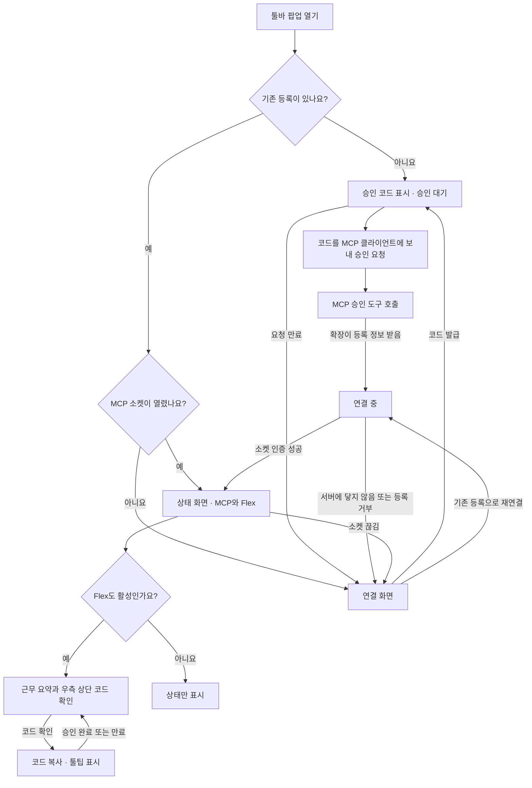

# Chrome 확장 팝업과 연결 승인

[상위 투두 9](https://github.com/freevue/flex-mcp/issues/9) · [디자인 기준](../../DESIGN.md) · [등록 순서도](browser-pairing.md)

확장은 Chrome 툴바 팝업 하나를 사용합니다. 서버 주소는 배포할 때 정합니다. 최초 등록은 사용자가 MCP 클라이언트에 요청합니다. 클라이언트가 MCP 도구로 승인하고 연결 키를 받습니다.

## 화면 흐름

승인 코드는 사용자가 팝업에서 MCP 클라이언트로 전달하는 값입니다. 팝업에는 승인 코드를 입력하는 칸이 없습니다. 등록이 이미 있으면 재연결을 먼저 할 수 있습니다. 열린 소켓이 있으면 상태 화면으로 갑니다.

팝업을 열거나 닫아도 기존 소켓은 유지합니다. 팝업을 다시 열었을 때 승인 요청이 아직 유효하면, 같은 코드를 표시합니다. 팝업에는 현재 상태에 필요한 행동만 표시합니다. 승인 요청은 사용 중인 에이전트 대화에서 합니다. 별도 서버 화면은 두지 않습니다.

## 화면과 상태

| 화면과 상태                | 표시                                                                                    | 사용자 행동                                                                                                                          |
| -------------------------- | --------------------------------------------------------------------------------------- | ------------------------------------------------------------------------------------------------------------------------------------ |
| 팝업 · 최초 연결           | 자동 발급한 승인 코드 영역                                                              | `코드 복사`를 눌러 MCP 클라이언트에 전달합니다.                                                                                      |
| 팝업 · 승인 대기           | 승인 코드와 대기 안내                                                                   | `코드 복사`를 누릅니다.                                                                                                              |
| MCP 클라이언트 대화        | 사용자의 승인 요청과 클라이언트의 결과 안내                                             | 복사한 코드로 연결 승인을 요청합니다.                                                                                                |
| 팝업 · 소켓 인증 대기      | 기존 연결 화면                                                                          | 연결이 끝날 때까지 기다립니다.                                                                                                       |
| 팝업 · 상태 화면           | `MCP 연결`과 `Flex 연결` 상태                                                           | 둘 다 활성화되면 [근무 요약](extension-work-summary.md)과 `코드 확인`을 표시합니다. 버튼을 누르면 코드를 복사하고 툴팁에 표시합니다. |
| 팝업 · 연결 끊김           | MCP 소켓이 연결되어 있지 않다는 안내                                                    | 기존 등록이 있으면 `다시 연결`을 누릅니다.                                                                                           |
| 팝업 · 승인 거절 또는 만료 | 승인이 거절되면 에이전트에 오류를 표시합니다. 요청이 만료되면 팝업에서 코드를 지웁니다. | 필요하면 새 코드를 발급합니다.                                                                                                       |
| 팝업 · 상태 확인 실패      | 연결 상태를 알 수 없다는 안내                                                           | 다시 확인합니다. 기존 등록은 유지합니다.                                                                                             |

소켓이 끊기면 연결 화면을 표시합니다. 서버에 닿지 않으면 코드 발급 실패를 알립니다. 기존 등록이 유효하면 재연결에 사용합니다. 등록을 해제할 때는 운영자가 서버에서 권한을 회수합니다.

기본 빌드의 `Flex 연결`은 `미연결`로 표시합니다. 이 상태에서는 근무 수치를 표시하지 않습니다. `FLEX_EXTENSION_DEMO=1`로 빌드하면 `합성 모드`와 예시 근무 요약을 표시합니다. 서버 소켓 상태를 Flex 로그인으로 해석하지 않습니다. 실제 Flex 상태는 [투두 7](https://github.com/freevue/flex-mcp/issues/7) 이후에 연결합니다.

## 구현 범위

최초 연결은 [투두 13](https://github.com/freevue/flex-mcp/issues/13)과 연결합니다. 팝업이 코드를 표시합니다. 사용자가 MCP 클라이언트에 승인을 요청합니다. 기존 옵션의 서버 주소와 코드 입력을 대체합니다.

상태 표시는 [투두 14](https://github.com/freevue/flex-mcp/issues/14)와 연결합니다. 서비스 워커는 확장의 백그라운드 작업입니다. 워커가 등록과 연결을 관리하고 팝업에는 표시할 값만 보냅니다. 팝업은 요청 키, 채널 ID와 확장 키를 표시하지 않습니다. 합성 근무 요약은 화면에 표시할 값만 받습니다.

근무 요약은 [이번 달 근무 요약](extension-work-summary.md)을 따릅니다. 오늘 실제 근무를 먼저 표시합니다. 이번 달 인정 근무에서 연차 포함과 미포함을 비교합니다. 남은 시간은 예정 연차 인정분을 반영해 놀수 전후 두 값만 표시합니다. 세부 값은 [MCP 도구](../mcp/tools/flex-get-work-summary.md)에서 읽습니다.

재연결은 [투두 15](https://github.com/freevue/flex-mcp/issues/15)와 연결합니다. 같은 등록으로 새 접속권을 받습니다. 시도 중에는 새 연결을 중복해서 시작하지 않습니다. 이전 등록과 소켓의 상태가 현재 표시를 바꾸지 않게 합니다.

## 설치 후 확인

아래 항목은 [직접 검증 절차](shared-connection-check.md)에 따라 설치한 Chrome 두 프로필에서 확인합니다.

| TC             | 확인할 동작                                            | 기대 결과                                                                       |
| -------------- | ------------------------------------------------------ | ------------------------------------------------------------------------------- |
| TC-F-EXT-UI-01 | 등록 없는 프로필에서 팝업을 엽니다.                    | 승인 코드와 복사 버튼만 본문에 표시합니다. 서버 주소와 코드 입력 칸은 없습니다. |
| TC-F-EXT-UI-02 | 코드를 MCP 클라이언트에 보내 연결 승인을 요청합니다.   | 확장이 승인 결과를 받아 연결합니다. 코드를 다시 입력하지 않습니다.              |
| TC-F-EXT-UI-03 | 승인을 거절하거나 요청이 만료됩니다.                   | 연결되지 않습니다. 다시 시도할 수 있습니다.                                     |
| TC-F-EXT-UI-04 | 등록한 프로필에서 서버 연결을 끊고 재연결합니다.       | 새 승인 없이 기존 등록으로 연결합니다.                                          |
| TC-F-EXT-UI-05 | 운영자가 한 프로필의 등록을 해제합니다.                | 그 프로필만 최초 연결을 표시합니다. 다른 프로필은 연결을 유지합니다.            |
| TC-F-EXT-UI-06 | 기본 빌드와 합성 모드 빌드를 각각 연결합니다.          | 두 상태를 따로 표시합니다. 합성 모드에서만 예시 근무 수치를 표시합니다.         |
| TC-F-EXT-UI-07 | 키보드로 연결과 코드 복사를 실행합니다.                | 버튼을 조작할 수 있습니다. 보조 기술이 상태 변경을 읽습니다.                    |
| TC-F-EXT-UI-08 | 승인 대기 중 팝업을 닫았다가 다시 엽니다.              | 유효한 승인 요청과 코드가 유지됩니다. 새 요청을 만들지 않습니다.                |
| TC-F-EXT-UI-09 | 두 연결이 활성일 때 `코드 확인`을 키보드로 실행합니다. | 코드를 복사하고 툴팁에 표시합니다. 근무 요약을 밀지 않습니다.                   |
| TC-F-EXT-UI-10 | MCP만 연결됐거나 승인한 코드를 다시 확인합니다.        | Flex가 미연결이면 버튼을 숨깁니다. 앞선 코드를 사용했으면 새 코드를 발급합니다. |
