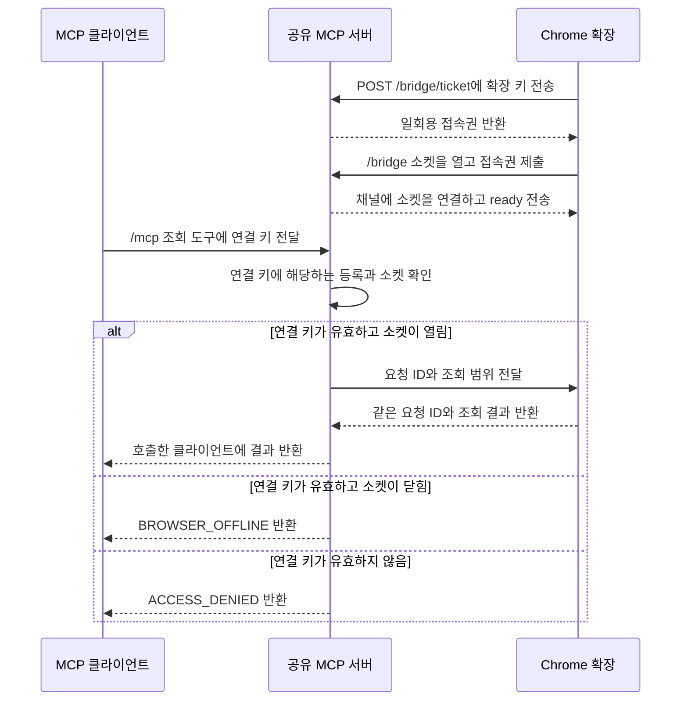

# 공유 MCP 연결 흐름

[투두 17](https://github.com/freevue/flex-mcp/issues/17) · [채널 접근 권한](access-control.md) · [Chrome 등록](browser-pairing.md) · [원격 전송](remote-bridge.md) · [직접 검증](shared-connection-check.md)

채널은 Chrome 등록과 그 등록에 연결한 소켓을 묶는 단위입니다. 서버는 채널마다 내부 등록 ID를 발급합니다. MCP 클라이언트는 등록 ID 대신 코드 승인 때 받은 연결 키를 사용합니다.

## 최초 등록

확장이 서버에 등록을 요청하고 받은 코드를 팝업에 표시합니다. 사용자는 코드를 MCP 클라이언트에 전달합니다. 클라이언트가 승인 도구를 호출하면 서버가 연결 키를 반환합니다. 요청 키를 가진 확장이 등록을 수령하면 연결 키가 활성화됩니다. [최초 등록 순서도](browser-pairing.md)를 참고하세요.

## 등록 이후의 조회

서버는 대기 중인 요청과 같은 소켓의 응답만 받습니다. 재접속하면 등록 ID와 연결 키를 유지합니다. 등록을 교체하거나 해제하면 이전 연결 키, 확장 키와 접속권을 무효화합니다.

합성 모드를 켠 확장은 합성 데이터를 반환합니다. 실제 Flex 조회는 별도 범위입니다. 실제 조회를 연결한 뒤에도 Flex 로그인은 Chrome에 남습니다.
