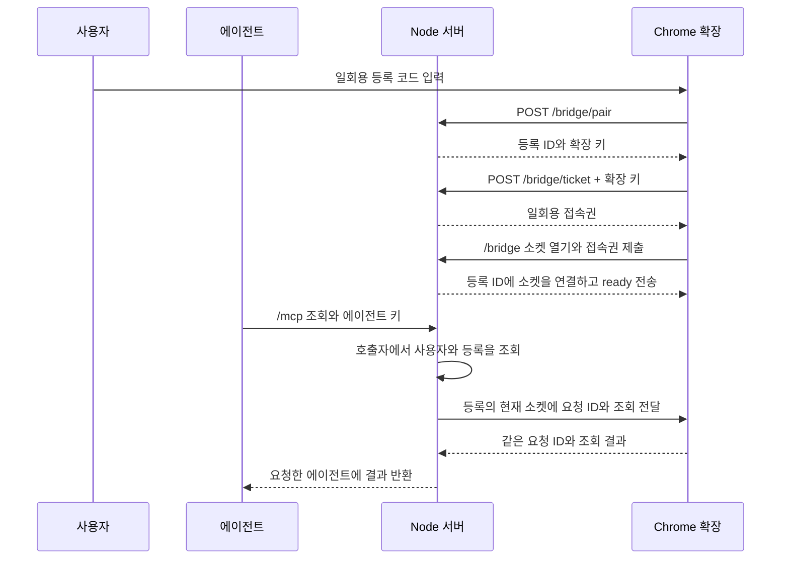

# 공유 MCP 연결 흐름

[투두 12](https://github.com/freevue/flex-mcp/issues/12) · [사용자 권한](access-control.md) · [Chrome 등록](browser-pairing.md) · [원격 전송](remote-bridge.md) · [직접 검증](shared-connection-check.md)

사용자 ID는 운영자가 발급한 계정 식별자입니다. 등록 ID인 `bindingId`는 서버가 Chrome 등록 하나에 붙이는 값입니다. 활성 소켓은 그 등록이 현재 사용하는 WebSocket 연결입니다. 사용자 한 명은 활성 등록 하나를 사용합니다.

서버는 검증한 에이전트 키에서 사용자 ID를 얻습니다. 요청 본문은 사용자나 등록을 선택하지 않습니다. 응답은 같은 등록의 같은 소켓과 대기 요청에만 도착합니다. 사용자의 Chrome이 오프라인이면 서버는 다른 사용자에게 보내지 않습니다.

재접속하면 등록 ID를 유지합니다. 서버는 새 소켓을 연결하고 이전 소켓을 닫습니다. 다시 등록하면 새 등록 ID를 발급합니다. 등록을 바꾸거나 해제하면 이전 확장 키와 접속권도 폐기합니다.

## 적용 범위

첫 실행은 합성 데이터 검증용입니다. 운영자가 사용자별 키와 등록 코드를 발급합니다. 일반 MCP 클라이언트를 위한 OAuth 연동과 실제 flex 조회는 별도 작업입니다. 승인된 실조회에서 flex 로그인은 Chrome 안에 남습니다.

| 흐름 | 기준 문서 |
| --- | --- |
| 등록 코드, 확장 키, 등록 해제 | [Chrome 등록](browser-pairing.md) |
| 에이전트 인증과 사용자별 권한 | [사용자 권한](access-control.md) |
| 같은 서버 주소의 HTTP와 WebSocket | [원격 전송](remote-bridge.md) |
| 사용자 두 명의 설치와 재접속 검증 | [직접 검증](shared-connection-check.md) |
