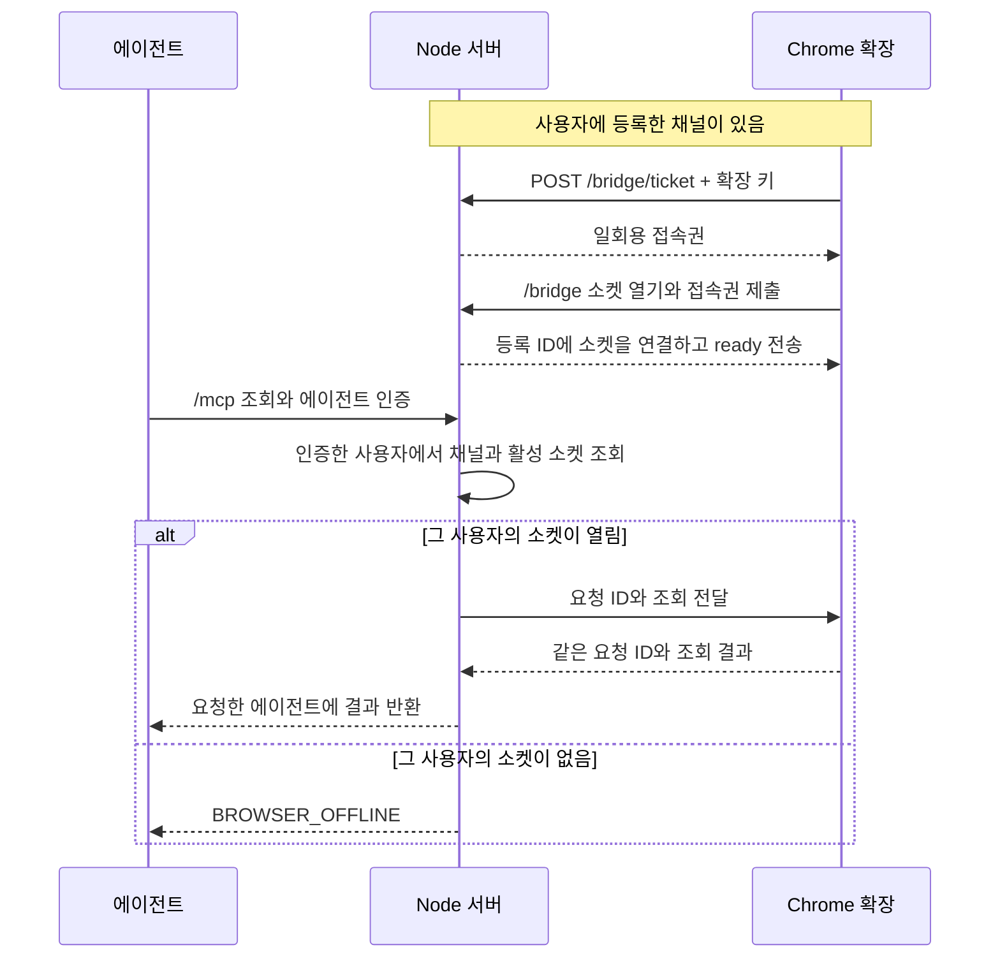

# 공유 MCP 연결 흐름

[투두 12](https://github.com/freevue/flex-mcp/issues/12) · [사용자 권한](access-control.md) · [Chrome 등록](browser-pairing.md) · [원격 전송](remote-bridge.md) · [직접 검증](shared-connection-check.md)

등록 ID인 `bindingId`는 서버가 Chrome 등록 하나에 붙이는 값입니다. 이 값을 채널 ID로 사용합니다. 활성 소켓은 현재 등록에 연결한 WebSocket입니다. 사용자 한 명은 활성 등록을 하나만 가질 수 있습니다.

## 최초 등록

확장이 연결을 시작합니다. 서버가 보낸 승인 코드를 팝업에 표시합니다. 사용자가 코드를 에이전트에 보냅니다. 에이전트가 MCP로 승인하면, 처음 요청한 확장만 등록 결과를 받습니다. [등록 순서도](browser-pairing.md)에서 승인과 등록을 확인합니다.

## 등록 이후의 조회

아래 순서는 등록 ID와 확장 키를 받은 뒤에 실행합니다. 조회 대상은 인증한 사용자에서 찾습니다. 에이전트의 입력으로 채널을 고르지 않습니다.

서버는 대기 중인 요청과 같은 소켓의 응답만 받습니다. 재접속하면 등록 ID를 유지하고 소켓만 바꿉니다. 새 Chrome 등록이 완료되거나 운영자가 등록을 해제하면, 서버는 이전 확장 키와 접속권을 무효화합니다.

## 확인 범위

합성 모드를 켠 확장은 합성 데이터를 반환합니다. 에이전트 인증에는 운영자가 발급한 사용자별 키를 사용합니다. 승인 도구는 승인 권한이 있는 키만 받습니다. MCP OAuth와 실제 Flex 조회는 아직 연결하지 않았습니다. 승인된 실제 조회에서 Flex 로그인은 Chrome 안에 남습니다.

| 확인할 내용 | 기준 문서 |
| --- | --- |
| 최초 승인, 접속권, 등록 해제 | [Chrome 등록](browser-pairing.md) |
| 팝업 상태와 에이전트 승인 | [화면 구성](extension-ui-plan.md) |
| 에이전트 인증과 사용자별 권한 | [사용자 권한](access-control.md) |
| 현재 빌드의 설치와 두 사용자 확인 | [직접 검증](shared-connection-check.md) |
