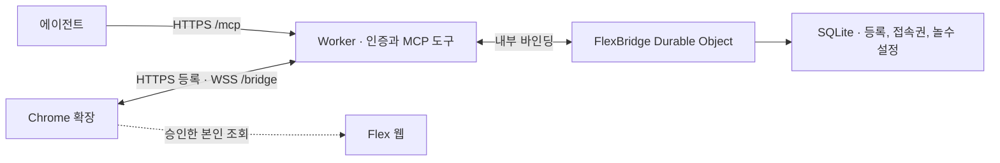

# Cloudflare Workers의 MCP 서버

[도구 목록](README.md) · [함수 목록](functions.md) · [예정 함수](workers/README.md) · [배포 검증](workers-release.md) · [원격 운영 투두](https://github.com/freevue/flex-mcp/issues/11)

상태: Workers 합성 검증 구현. 저장소 루트의 `wrangler.jsonc`가 Worker를 빌드합니다. 로컬 Workers와 운영 번들의 모의 실행을 확인했습니다. 운영 배포, OAuth와 실제 Flex 연동은 아직 검증하지 않았습니다.

운영 도메인은 `flex-mcp.freevue.dev`입니다. MCP 클라이언트는 `https://flex-mcp.freevue.dev/mcp`를 사용합니다. Chrome 확장의 서버 주소는 `https://flex-mcp.freevue.dev`입니다. 확장은 이 주소로 등록 요청을 보내고 `wss://flex-mcp.freevue.dev/bridge`에 연결합니다.

## 실행 구조

Worker는 외부 HTTPS 요청을 받습니다. Durable Object는 같은 저장소와 연결 상태를 관리하는 Cloudflare 실행 단위입니다. 첫 버전은 환경마다 SQLite를 쓰는 `FlexBridge` 하나를 둡니다. 그래야 Chrome이 기존처럼 채널 ID 없이 같은 `/bridge` 주소로 연결할 수 있습니다. 여러 사용자 연결은 객체 안에서 등록 ID로 분리합니다.

현재 Worker는 기존 서버와 같은 MCP SDK v1의 Web 표준 Streamable HTTP 전송을 사용합니다. 요청마다 MCP 서버를 생성합니다. 브라우저 등록과 소켓 상태는 Durable Object가 관리합니다. MCP 요청 자체는 세션에 의존하지 않습니다.

운영 전 다음 단계에서는 [Cloudflare MCP 안내](https://developers.cloudflare.com/agents/model-context-protocol/guides/remote-mcp-server/)의 `createMcpHandler`를 검토합니다. SDK를 바꿀 때는 [SDK v2 이식 안내](https://developers.cloudflare.com/agents/model-context-protocol/guides/migrate-to-mcp-sdk-v2/)의 `@modelcontextprotocol/server`를 사용합니다. 함께 쓸 Agents SDK와 서버 SDK 버전을 고정합니다. 현재 클라이언트는 [기존 클라이언트 호환 방식](https://developers.cloudflare.com/agents/model-context-protocol/apis/handler-api/#compatibility-with-legacy-clients)으로 목록과 호출을 확인합니다. 클라이언트가 독립 GET 스트림, 세션 삭제 또는 이벤트 재생을 요구하면 호환 조건을 따로 정합니다.

## 인증과 경로

현재 합성 검증 Worker는 사용자별 Bearer 키를 확인합니다. `FLEX_WORKER_AGENTS`의 키 해시로 사용자를 찾고 승인 권한을 따로 확인합니다. 환경 설정이 없거나 잘못되면 호출을 차단합니다. OAuth는 사용자가 클라이언트에 제한된 접근을 허용하는 방식입니다. 운영에서는 [Cloudflare OAuth 안내](https://developers.cloudflare.com/agents/model-context-protocol/protocol/authorization/)의 권한 서버와 리소스 서버 방식을 사용합니다. 배포 전에 대상 MCP 클라이언트로 로그인과 토큰 검증을 확인합니다. 승인된 사용자와 에이전트를 서버의 내부 ID에 연결합니다. 요청 본문에서 사용자 ID를 받지 않습니다.

| 외부 경로 | 호출자와 동작 |
| --- | --- |
| `/mcp` | 에이전트가 Streamable HTTP로 호출합니다. Worker는 토큰과 요청 출처를 확인합니다. 읽기 권한과 Chrome 연결 승인 권한을 나눕니다. |
| `POST /bridge/pair/start`, `POST /bridge/pair/claim` | 등록한 확장 출처만 받습니다. 시작 요청에는 별도 요청 제한을 둡니다. 수령에는 비공개 요청 키가 필요합니다. |
| `POST /bridge/ticket`, `POST /bridge/unpair` | 허용한 확장 출처와 확장 키를 확인합니다. |
| `GET /bridge` | 허용한 확장 출처의 WebSocket 전환을 전달합니다. 확장이 첫 메시지로 일회용 접속권을 보냅니다. |

운영에서 확장 출처는 허용 목록입니다. 출처 값만으로 신원을 확인하지 않습니다. 등록 시작의 허용량과 만료 시각을 검증합니다. 승인 코드는 5분, 접속권은 30초 동안 유효합니다. 소켓은 5초 안에 인증해야 합니다. 요청 키, 확장 키와 접속권을 주소에 넣지 않습니다.

기존 Node의 운영자용 `POST /bridge/pair`는 호환 경로입니다. 첫 Workers 배포에서는 열지 않습니다. 필요하면 승인 범위와 종료 시점을 먼저 정합니다. 테스트 환경에서 기존 키를 쓸 경우 운영 인증과 분리합니다.

## 저장과 소켓

기존 Node의 `node:http` 서버 진입점은 Workers의 `fetch`로 옮깁니다. `ws` 소켓 서버는 Durable Object의 WebSocket 수명 주기로 옮깁니다. 상태 파일은 Durable Object의 [SQLite 저장소](https://developers.cloudflare.com/durable-objects/api/sqlite-storage-api/)로 옮깁니다. 같은 SQLite라도 파일과 저장 API가 다릅니다. Node용 서버 패키지를 그대로 업로드하지 않습니다.

| 데이터 | 저장 규칙 |
| --- | --- |
| 에이전트 권한, 확장 등록, 승인 요청, 접속권 | 등록 관계와 만료 시각을 보관합니다. 일회용 코드, 요청 키, 확장 키와 접속권은 해시만 저장합니다. |
| 놀수 날짜 | 허용된 정책 범위의 날짜만 보관합니다. `(policyId, date)`를 중복 없이 저장하고, 월 설정의 유무를 구분합니다. 승인된 관리자 경로가 정해지기 전에는 공개 쓰기 API를 만들지 않습니다. |
| 활성 소켓 | 인증한 소켓에 등록 ID를 연결합니다. 재시작 뒤 저장한 등록을 다시 검사합니다. 키와 Flex 자료는 소켓 부가 정보에 넣지 않습니다. |
| 대기 중인 조회와 결과 | 메모리에만 둡니다. 요청 ID와 보낸 소켓이 일치해야 결과를 받습니다. 종료나 시간 초과 뒤에 요청을 재실행하지 않습니다. |

놀수 설정은 아래처럼 나눌 예정입니다. 현재 Worker는 놀수 날짜를 저장하거나 요약을 계산하지 않습니다. 월 행만 있고 날짜가 없으면 휴무가 없다고 확인한 달입니다. 월 행이 없으면 설정이 없는 달입니다.

| 예정 테이블 | 필드 | 연결과 고유 조건 |
| --- | --- | --- |
| `nolsu_months` | `policy_id`, `month` | 정책과 월의 조합을 한 번만 등록합니다. 월은 한국 시간의 `YYYY-MM`입니다. |
| `nolsu_dates` | `policy_id`, `month`, `date` | 같은 정책에 날짜를 중복 등록하지 않습니다. 그 날짜가 속한 월 행을 참조합니다. |

승인 수령, 기존 등록 교체와 접속권 사용은 각각 하나의 트랜잭션으로 처리합니다. 트랜잭션은 여러 저장 작업을 함께 반영하는 단위입니다. [SQLite 저장소의 `transactionSync`](https://developers.cloudflare.com/durable-objects/api/sqlite-storage-api/#transactions)를 사용합니다. 승인 권한을 회수하면 승인만 받은 요청으로 등록을 발급하지 않습니다. 등록을 바꾸거나 해제하면 이전 소켓과 대기 조회를 닫습니다.

[WebSocket 절전 API](https://developers.cloudflare.com/durable-objects/best-practices/websockets/)로 소켓을 유지합니다. 절전은 실행 메모리를 비워도 연결을 유지하는 방식입니다. `serializeAttachment`에는 등록 ID 등 연결을 복구하는 최소 정보만 둡니다. 오래된 등록을 다시 승인하지 않습니다. 메모리의 대기 요청은 복구하지 않습니다. 현재 확장의 JSON `ping`과 프로토콜 ping은 다릅니다. JSON 왕복과 절전 복귀를 별도로 확인합니다.

첫 한도는 Node 기준인 대기 조회 32건, 단일 중계 8초, 소켓 메시지 64 KiB를 출발점으로 삼습니다. 환경별 부하 결과로 확정합니다. 한 객체의 상한에 가까우면 연결 수와 대기 시간을 먼저 측정합니다.

## 근무 요약 연결

[근무 요약](tools/flex-get-work-summary.md)은 새 배포에서 연결할 도구입니다. 날짜 설정과 계산은 로컬 Ego 코드를 업로드하지 않고 이식합니다. Worker는 토큰에서 확인한 사용자와 현재 확장 등록으로만 근무 범위를 조회합니다. 범위별 읽기 사이에 등록이나 권한이 바뀌면 결과 전체를 버립니다.

오늘, 월 누적, 월 전체 목표를 먼저 읽습니다. 확인한 놀수 날짜가 있으면 그 날짜를 포함한 월 구간의 합을 월 전체 목표와 비교합니다. 합이 다르거나 휴무 목표가 없으면 반영 값은 `null`입니다. 단일 중계 제한과 전체 요약 호출 제한을 따로 두고, 전체 제한을 넘으면 미완료 조회를 끝냅니다.

실제 Flex 조회는 승인한 Chrome 프로필에서만 실행합니다. Workers, 공개 빌드와 로그에는 Flex 로그인 정보, 비공개 경로, 실응답 원본과 사내 날짜 설정 원본을 넣지 않습니다. 공개 빌드는 합성 자료로 먼저 검증합니다.

## 테스트 케이스

| TC | 실행 | 기대 결과 |
| --- | --- | --- |
| TC-W-ARCH-01 | 권한 없는 호출로 MCP와 확장 경로를 호출합니다. | 유효한 호출자의 등록이나 결과를 반환하지 않습니다. |
| TC-W-ARCH-02 | 서로 다른 사용자 두 명으로 등록, 연결과 조회를 동시에 실행합니다. | 각 결과와 상태가 해당 사용자에게만 갑니다. |
| TC-W-ARCH-03 | 같은 승인 수령과 접속권 사용을 각각 두 번 시도합니다. | 각 값은 한 번만 사용됩니다. |
| TC-W-ARCH-04 | 절전 복귀, 등록 교체와 대기 중 권한 회수를 각각 실행합니다. | 이전 요청이나 이전 소켓의 결과를 전달하지 않습니다. |
| TC-W-ARCH-05 | 놀수가 들어 있는 달과 차감 자료가 부족한 달을 조회합니다. | 확인한 날짜만 뺍니다. 근거가 없으면 반영 값은 `null`입니다. |
